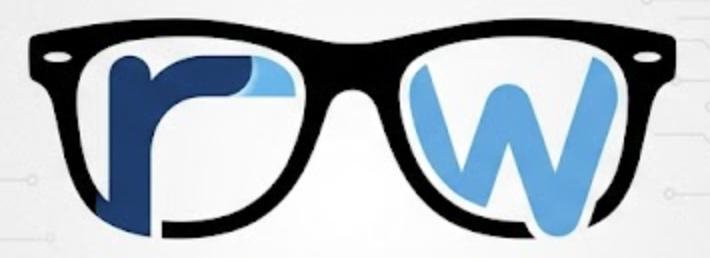

<div align="center">
  

  [Specs](docs/specs/) | [Examples](examples/) | [Issues](https://github.com/ryuichi1208/rw/issues) | [Changelog](CHANGELOG.md)
</div>

This is the main source code repository for **rw** — a statically typed,
async-first compiled language with a Python-flavored surface syntax. It
contains the compiler, the C runtime, and the language specs.

## Why rw?

- **Async first:** `spawn` / `await` and `Future[T]` are first-class. The
  fiber runtime handles 100k+ tasks on a single thread.
- **Familiar syntax:** Indentation, `def`, `elif`, `and` / `or` / `not`,
  `true` / `false`.
- **Static types:** All parameters, returns, and locals are annotated.
- **LLVM backend:** Native binaries on macOS arm64 and Linux x86_64.

## Quick Start

```sh
uv sync --extra dev
make -C runtime
uv run rwc run examples/hello.rw
```

For installation prerequisites and detailed setup, see [INSTALL.md](INSTALL.md).

## A web server in rw

`examples/web.rw` is a small web framework written in rw, with routing, path
parameters, and an HTTP/1.1 server that handles each connection in its own
fiber:

```rw
import web
from web import App, Request, Response, text, param

def hello(req: Request) -> Response:
    return text(200, "hello, " + param(req, "name") + "\n")

def main() -> int:
    app: App = web.new_app()
    web.get(app, "/hello/:name", hello)
    return web.serve(app, 8080)
```

```sh
uv run rwc run examples/web_app.rw   # curl -i http://127.0.0.1:8080/hello/rw
```

See [docs/web-framework.md](docs/web-framework.md) for the API.

## Getting Help

See [Issues](https://github.com/ryuichi1208/rw/issues) and the language specs
under [`docs/specs/`](docs/specs/).

## Contributing

Contribution guidelines are tracked in
[#71](https://github.com/ryuichi1208/rw/issues/71). For now, pick any open
issue and send a pull request.
